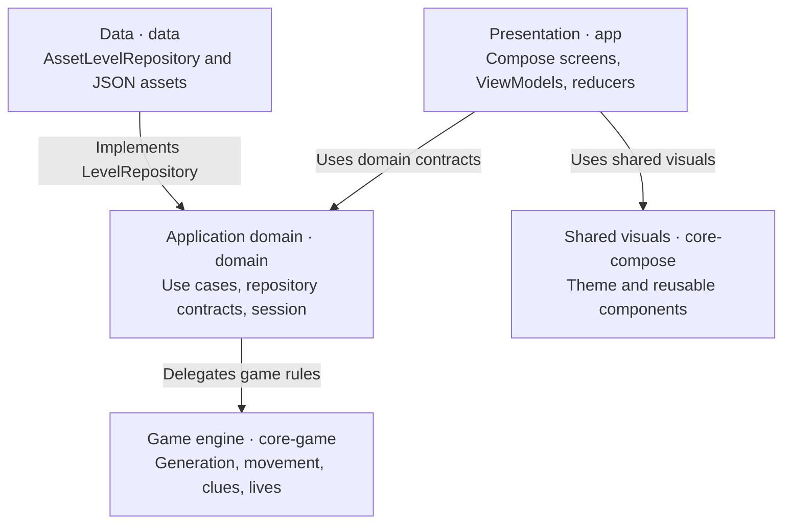
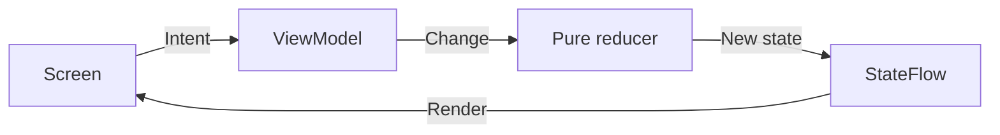
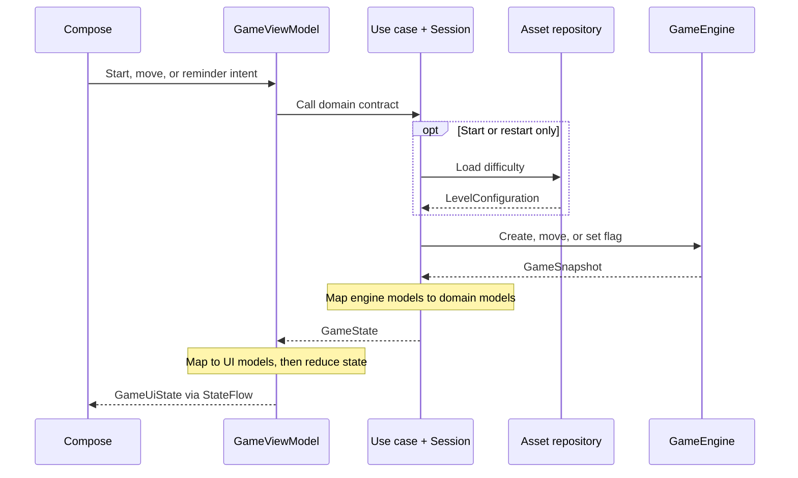
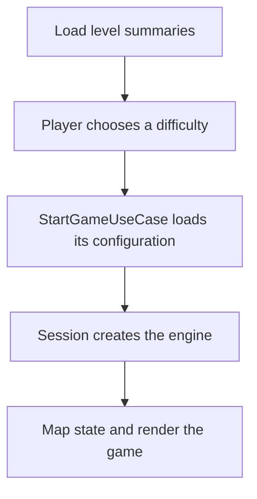
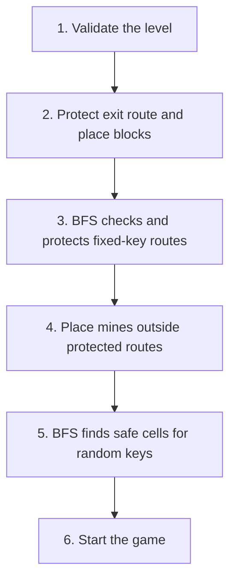

# Mine Sweeper

An offline, single-player Android grid puzzle built with Kotlin and Jetpack Compose. Guide a player across a generated board, use adjacent mine/key clues to explore, collect every key, avoid mines and blocks, and reach the exit. Unlike classic Minesweeper, discovery happens by moving a player rather than opening arbitrary cells.

There are three bundled difficulties (Easy, Medium, Hard). The app has no API calls, sign-in, database, or required network connection. Each new game is generated from a local JSON level definition.

## Game preview

Existing captures from a Nexus 5X / API 28 emulator. The gameplay images show the same Easy session and compact movement controls. The difficulty-selection image predates the current metadata labels; level choices now also show board size and mine/key counts.

<table>
  <tr>
    <th>Choose a difficulty</th>
    <th>Explore using clues</th>
    <th>Mark a reminder</th>
  </tr>
  <tr>
    <td></td>
    <td></td>
    <td></td>
  </tr>
</table>

### Rules at a glance

| Feature | Rule |
| --- | --- |
| Discovery | Mines, keys, and unvisited floor cells are hidden. Start, blocks, and exit are visible. |
| Movement | Use the arrows to move one cell north, south, east, or west. Tapping a board cell selects it for a reminder; it does not move the player or reveal the cell. |
| Clues | `M#` and `K#` count mines and keys in the **eight surrounding cells**, including diagonals. Counts describe the original board, so collecting a key does not reduce nearby key clues. |
| Flags | `M?` and `K?` are editable guesses, not confirmed contents. They do not block movement, consume moves, or affect victory. |
| Lives | A mine costs one life and leaves the player on the previous safe cell. Games currently start with one life; the engine supports more. |
| Victory | Collect every key, then reach the unlocked exit. |
| Game over | At zero lives, the game ends. Win and loss both reveal the board for review. |

## Developer guide

- [Quick start](#quick-start)
- [Architecture and layers](#architecture-and-layers)
- [Models and mapping boundaries](#models-and-mapping-boundaries)
- [Presentation: lightweight MVI](#presentation-lightweight-mvi)
- [How a game starts and changes](#how-a-game-starts-and-changes)
- [Dependency injection and session ownership](#dependency-injection-and-session-ownership)
- [Game algorithm and BFS](#game-algorithm-and-bfs)
- [Data and level format](#data-and-level-format)
- [Compose and performance](#compose-and-performance)
- [Tests and contributor workflow](#tests-and-contributor-workflow)

## Quick start

### Requirements

- JDK 11.
- Android SDK Platform 31 and Build Tools 30.0.2.
- An emulator or Android device running API 21 or newer.
- The included Gradle wrapper; a separate Gradle installation is not needed.

Configure the SDK using `ANDROID_SDK_ROOT` or a local `local.properties` containing `sdk.dir=/path/to/Android/sdk`. Use JDK 11 for Gradle, through `JAVA_HOME` or your IDE's Gradle JVM setting. Android Studio is not required for the command-line workflow.

Build from the repository root:

```bash
./gradlew :app:assembleDebug
```

The APK is written to `app/build/outputs/apk/debug/app-debug.apk`. With `adb` available on your PATH and an emulator running:

```bash
adb devices
adb -s emulator-5554 install -r app/build/outputs/apk/debug/app-debug.apk
adb -s emulator-5554 shell am start -n com.mohdroid.minesweeper/.MainActivity
```

Replace `emulator-5554` with the identifier shown by `adb devices`. Select a difficulty, move with the direction buttons, and tap covered cells to set reminder flags.

The game is offline. A first build may still need internet access to download Gradle and library dependencies; `--offline` works only after those dependencies are cached.

## Architecture and layers

The project has **five Gradle modules**. Presentation is organized by feature inside `app`; there are no separate feature Gradle modules.

```text
app/           Android entry point, navigation, level/game MVI, UI models, app DI
domain/        Application use cases, public models, repository contract, session coordination
data/          Bundled JSON assets, DTO mapping, asset repository, data DI
core-game/     Reusable Kotlin engine, board generation, rules, engine models
core-compose/  Shared Compose theme and visual primitives
```

### Layer architecture

This view shows each layer's responsibility and dependencies, rather than every Gradle dependency. Arrows mean **uses** or **implements**, as labeled; they do not show execution order.



Feature ViewModels depend on **domain use-case contracts**, not repository implementations or `GameEngine`. The level-loading contract belongs to domain and its implementation belongs to data. The engine knows nothing about the other layers; shared visuals contain no gameplay logic.

### Responsibilities and decisions

| Module | Owns | Must not own |
| --- | --- | --- |
| `app` | ViewModels, presentation state, pure reducers, Compose, navigation, UI mapping. | Board-generation rules, engine internals, asset parsing in feature code. |
| `domain` | Application operations, level-loading port, engine adapters, active-session coordination. | Android context, JSON DTOs, Compose, navigation. |
| `data` | Asset reading, Gson DTOs, mapping to domain models, `LevelRepository` implementation. | Gameplay rules or presentation models. |
| `core-game` | Generation, safe reachability, movement, clues, reminders, lives, victory, visible snapshots. | Repositories, use cases, Android, Compose, Gson, Koin. |
| `core-compose` | Reusable visual primitives and theme. | Game-specific feature state or business rules. |

This applies Clean Architecture through dependency inversion and explicit model boundaries. There is one deliberate framework choice: **Koin is allowed in the dedicated `di` packages of app, domain, and data**. Domain business classes still use constructor injection and have no Android or Koin imports. The engine remains entirely DI-free.

The repository contract is defined in `domain` and implemented in `data`. It supplies level definitions; it does not own the engine or become a general-purpose game controller. Gameplay orchestration belongs to use cases and the domain session.

### Domain operations

| Public contract | Operation | Implementation |
| --- | --- | --- |
| `LoadLevelsUseCase` | Load and order the available level summaries. | `DefaultLoadLevelsUseCase` |
| `StartGameUseCase` | Load a difficulty and create a fresh game. Used for both initial start and restart. | `DefaultStartGameUseCase` |
| `GameInteraction` | Move the player or set/change/toggle/clear a reminder in the current session. | `DefaultGameInteraction` |
| `ExitGameUseCase` | Clear the game and invalidate unfinished starts. | `DefaultExitGameUseCase` |

These interfaces are public; their default implementations are module-internal. Use cases coordinate application behavior, while detailed game rules remain in the reusable engine.

### Source map

| Start here | Purpose |
| --- | --- |
| [Level feature](app/src/main/java/com/mohdroid/minesweeper/feature/level/) | `LevelRoute`, `LevelScreen`, `LevelViewModel`, reducer, contracts, models, mapper, components. |
| [Game feature](app/src/main/java/com/mohdroid/minesweeper/feature/game/) | `GameRoute`, `GameScreen`, `GameViewModel`, reducer, contracts, models, mappers, components. |
| [MainNavGraph](app/src/main/java/com/mohdroid/minesweeper/navigation/navgraphs/MainNavGraph.kt) | Connects feature routes and passes the selected difficulty identifier. |
| [Domain use cases](domain/src/main/kotlin/com/mohdroid/domain/game/usecase/) | Contracts and implementations grouped by `level`, `start`, `interaction`, and `exit`. |
| [GameSessionCoordinator](domain/src/main/kotlin/com/mohdroid/domain/game/session/GameSessionCoordinator.kt) | Owns the active engine, coordinates requests, and prevents stale activation. |
| [LevelRepository](domain/src/main/kotlin/com/mohdroid/domain/game/repository/LevelRepository.kt) | Source-independent level-loading interface. |
| [AssetLevelRepository](data/src/main/java/com/mohdroid/data/game/repository/AssetLevelRepository.kt) | Reads local assets and returns domain configurations/summaries. |
| [GameEngine](core-game/src/main/kotlin/com/mohdroid/game/domain/engine/GameEngine.kt) | Authoritative board generation and gameplay behavior. |
| [AppModule](app/src/main/java/com/mohdroid/minesweeper/di/AppModule.kt) | Koin ViewModel factories and destination-owned game scopes. |
| [core-compose](core-compose/src/main/java/com/mohdroid/compose/) | Shared theme and reusable UI primitives. |

## Models and mapping boundaries

There is no global model or mapper module. Each layer owns the representation it exposes.

| Owner | Models | Meaning |
| --- | --- | --- |
| `data/game/model` | `LevelJsonDto`, `AssetJsonDto`, `PositionJsonDto` | Internal JSON transport format. |
| `domain/game/model/level` | `Difficulty`, `LevelSummary`, `LevelConfiguration`, `LevelAsset` | Available difficulties and source-independent level setup. |
| `domain/game/model/board` | `CellState`, `Position`, `Direction`, `Reminder`, `TileKind` | Domain board state and interaction inputs. |
| `domain/game/model/session` | `GameState`, `GamePhase` | Application-facing state of one game. |
| `core-game/domain/model` | `LevelDefinition`, `GameSnapshot`, `CellSnapshot` and engine enums | The engine library's own contract. |
| `app/feature/level` | `LevelUiState`, `LevelItemUiModel`, intents and navigation requests | Level-screen rendering and interaction. |
| `app/feature/game` | `GameUiState`, `GameBoardUiModel`, `CellUiModel`, intents and navigation requests | Game-screen rendering and interaction. |

Mappings are explicit:

```text
Loading:   JSON DTO → LevelConfiguration → engine LevelDefinition
Rendering: engine GameSnapshot → domain GameState → GameBoardUiModel → Compose
Input:     presentation direction/reminder → domain input → engine input
```

- **Data mappers** translate DTOs into domain configurations and summaries.
- **Domain mappers** adapt between the domain contract and engine types.
- **Presentation mappers** translate domain state and UI inputs. For example, a visited key becomes `COLLECTED_KEY`, and an exit becomes `LOCKED_EXIT` or `OPEN_EXIT`.

Compose screens, navigation, and UI models do not consume engine snapshots. ViewModels use domain contracts and presentation mappers. The engine's mutable `Cell` class is internal and never exposed as a UI model.

## Presentation: lightweight MVI

Both features use the same unidirectional flow, without an additional MVI framework:



The ViewModel owns and publishes the `StateFlow`; the reducer simply returns the next state.

| Part | Responsibility |
| --- | --- |
| `Intent` | Typed user or lifecycle input: select a level, move, set a reminder, retry, review, exit, acknowledge navigation. |
| ViewModel | Handle intents, call domain use cases, map results, dispatch internal changes. |
| `Change` | Internal presentation message describing a transition or operation result. |
| Reducer | Pure `reduce(previousState, change)` function. No I/O, Koin, navigation, or engine calls. |
| `UiState` | Read-only rendering state, including loading, board/levels, selection, error, and pending navigation. |
| Route | Obtain the destination's ViewModel, collect state, perform navigation, acknowledge handled requests. |
| Screen | Render supplied state and send intents. It has no ViewModel, Koin, or navigation dependency. |

### Feature ownership

`LevelViewModel` loads the catalogue from existing assets through `LoadLevelsUseCase`, maps metadata for display, validates the selected identifier, and prevents repeated navigation from rapid taps. It **does not create a game session**.

`GameViewModel` starts the selected difficulty once, handles gameplay/restart/exit, and owns presentation state for selected cells and board review. Game validity, clues, lives, and victory are still engine decisions. Scroll positions remain local Compose state.

### Lifecycle and navigation effects

Navigation uses **typed, retained requests in UI state**, not a fire-and-forget event channel:

1. The ViewModel publishes `pendingNavigation`.
2. The route handles it only while its destination is `RESUMED`.
3. After navigation, the route sends `NavigationHandled` to clear that request.

The level feature keeps choices disabled until its destination resumes after gameplay. The game feature makes repeated exit intents idempotent. This policy retains pending requests during backgrounding while the ViewModel survives and avoids replaying acknowledged requests on resume. It does not provide persistence across process death.

[LifecycleCollection.kt](app/src/main/java/com/mohdroid/minesweeper/ui/lifecycle/LifecycleCollection.kt) provides helpers compatible with the existing library versions: rendering collects at `STARTED` or above, and navigation collects only at `RESUMED`. Subscriptions stop below those thresholds and restart with the latest state. This pauses collection, not independent work already running in `viewModelScope`.

### Loading and recovery

`LevelUiState` has `LOADING`, `READY`, and `ERROR` states. `GameUiState` also has `IDLE` for an uninitialized or exited game.

Presentation errors are categories defined by [UiError](app/src/main/java/com/mohdroid/minesweeper/ui/error/UiError.kt), mapped to string resources in Compose:

| Error | Recovery |
| --- | --- |
| `LEVEL_LOADING_FAILED` | Retry the catalogue load. |
| `GAME_LOADING_FAILED` | Retry the selected difficulty. |
| `INVALID_LEVEL_SELECTION` | Return to level selection; do not offer a retry without a valid difficulty. |

Raw exception messages are not displayed as loading errors. Cancellation is not converted into a loading failure, and stale results cannot replace a restarted or exited game. The existing interaction-error policy is unchanged: failed movement/reminder results leave the published UI state as it was.

## How a game starts and changes

### Game action and data flow

This sequence shows the successful start/restart, movement, or reminder flow. It separates calls from the models returned across each boundary.



Movement and reminders reuse the active engine; they do not read assets again. Selecting a cell and reviewing the board only change presentation state. Exit uses the acknowledged navigation flow described above.

### Load choices, then start a game



The level catalogue and game start are separate operations:

1. `LevelViewModel → LoadLevelsUseCase → LevelRepository.loadLevels()` loads dimensions and mine/key counts without creating an engine.
2. The level route navigates with **only the difficulty identifier**, not a board object or shared ViewModel.
3. The new game destination obtains its own `GameViewModel`, which invokes `StartGameUseCase`.
4. The start use case obtains a configuration through `LevelRepository.loadLevel(difficulty)`, then activates the domain session.
5. `GameSessionCoordinator` creates `GameEngine`, maps the initial snapshot to `GameState`, and returns it. The ViewModel maps that into UI state.

Asset reading and JSON conversion run on IO. Engine generation and initial engine-to-domain mapping run on `Dispatchers.Default`. The ViewModel publishes presentation state on its UI dispatcher.

### Move, mark, restart, or exit

- **Select a cell:** UI intent → game reducer → selected-cell state. No asset read, engine generation, movement, or reveal.
- **Move or mark:** UI intent → `GameInteraction` → shared session → existing engine → domain state → presentation mapping → reducer.
- **Restart:** invoke the same `StartGameUseCase` for the current difficulty. This reloads its definition and creates a fresh layout and counters.
- **Exit:** cancel pending loading, invalidate and clear the active session, then publish a back-navigation request.

A new start invalidates older domain requests. Cancellation plus request-generation guards prevent delayed results from reopening a game after restart or exit.

## Dependency injection and session ownership

[MineSweeperApplication](app/src/main/java/com/mohdroid/minesweeper/MineSweeperApplication.kt) starts Koin with three definitions:

| Koin module | Provides |
| --- | --- |
| `gameDataModule` | Asset reader wiring, IO dispatcher, singleton `LevelRepository` implementation. |
| `gameDomainModule` | Catalogue use case, computation dispatcher, game-scoped session and gameplay use cases. |
| `appModule` | Level ViewModel and parameterized game ViewModel factories. |

Each game navigation destination owns its ViewModel. Its Koin factory creates a unique game scope, where `StartGameUseCase`, `GameInteraction`, and `ExitGameUseCase` all share one internal `GameSessionCoordinator`. A second game destination gets a different session.

The internal `GameSession` interface gives use cases access to start/activate, move, reminder, and exit operations without exposing the engine to presentation. Koin assembles these objects; it does **not** replace the need for session ownership or coordination.

Exiting clears the active game. When the game ViewModel is cleared, it also closes its Koin scope; the session's scope-close hook clears any remaining engine state. There is no activity-wide game ViewModel or manually assembled production `GameUseCases` container.

## Game algorithm and BFS

The central API is `GameEngine.create(level, seed, startingLives)` followed by `engine.move(direction)`, `engine.setFlag(position, flag)`, and `engine.snapshot()`. The engine owns the true mutable board internally; its callers in `domain` receive engine `GameSnapshot` / `CellSnapshot` values containing only player-visible information. Plain public models live in separate files under `domain.model`, not in `GameEngine.kt`. Domain mappers first adapt engine snapshots into `GameState`; presentation mappers then produce UI models before anything reaches Compose. The optional seed makes random placement reproducible in tests. `startingLives` defaults to one, but the rule supports higher values. Normal gameplay uses a fresh seed, so **Try again** creates a new layout from the same difficulty definition.

### 1. Validate and generate a board

`LevelDefinition.validate()` requires a positive board size, exactly one start and one exit, explicit positions for both, non-negative counts, in-bounds and non-duplicate explicit positions, and no more requested tiles than board cells. `GameEngine.create` returns a `Result` failure if validation or placement cannot succeed; the failure passes through the domain start contract and becomes a retryable presentation error.

Generation then:

1. Fills the rectangular board with `STEP` cells and places the explicit `START` and `EXIT`.
2. Computes a direct route from start to exit: first along rows, then along columns. This is the *protected path*.
3. Places all other explicitly positioned assets. An explicit block or mine on the protected path is rejected.
4. Randomly places remaining blocks outside the protected path.
5. Runs **breadth-first search (BFS)** through non-block, non-mine cells to check that explicitly positioned keys are reachable without crossing the locked exit. It reserves safe routes to those keys and the exit.
6. Places remaining mines outside those routes, then runs BFS again, treating mines, blocks, and the locked exit as impassable. Random keys are placed only in safely reachable cells. If a mine layout leaves too few valid key cells, it retries the random placement. Any unassigned cells stay as `STEP`.

Candidates are shuffled with the session's seed before selection. This gives deterministic layouts for a fixed level and seed while varying layouts in ordinary play. The protected route stays clear of blocks and mines; every key has a mine-free route from the start that does not require passing through the locked exit. Explicitly positioned assets are authoritative. Impossible level constraints are reported as a failure rather than silently changing the level.



This diagram shows the successful path. Invalid definitions or fixed placements fail immediately. If random mine/key placement cannot satisfy the constraints, generation retries that placement up to 128 times, then reports failure.

**Where BFS is used:** `reachablePositions` explores cardinal neighbors with a FIFO queue and a visited set to check whether safe paths exist. `safePath` also uses BFS, recording parent positions so a route to an explicitly positioned key can be reconstructed and protected. These searches exclude blocks, mines when requested, and the locked exit when checking key access.

**What BFS does not do:** it does not randomly place assets, construct the initial row/column exit corridor, or reveal cells during play. The generator combines seeded random placement with BFS reachability checks. A single BFS visits at most the board's cells and their four edges per cell: **O(rows × columns)** time and space. Generation may run several searches and up to 128 placement attempts; it is not just one BFS.

The guarantee is **safe reachability**, not that every board can be solved from clues without guessing. Clues use eight neighbors; movement and BFS use four.

### 2. Apply a movement

Each direction moves one row or column; there is no diagonal movement. `GameEngine.move` checks the proposed cell before changing state:

| Condition | Result |
| --- | --- |
| Game already won or lost | Ignore the move. |
| Target outside the board or a `BLOCK` | Ignore the move. |
| Target is `EXIT` with keys still missing | Ignore the move; the door stays locked. |
| Target is an uncollected `KEY` | Move, reveal it, and increment collected keys. |
| Target is an unrevealed `MINE` | Consume one life, reveal it, and stay on the previous safe cell; enter `LOST` at zero lives. |
| Target is an already revealed `MINE` | Ignore the move; it cannot consume another life. |
| Target is an unlocked `EXIT` | Move and enter `WON`. |
| Other traversable target | Move, reveal it, and show its adjacent mine/key counts. |

Only accepted moves, including a first mine hit, increase the move count. A key counts once even if the player revisits its cell. The exit unlocks when `foundKeys == totalKeys`; reaching it then wins the game. A terminal phase stops further movement. Flags (`NONE`, `MINE`, `KEY`) are editable reminders on covered cells; they neither block movement nor change clues or victory conditions.

### 3. Publish a renderable snapshot

`GameSnapshot` contains the player position, counters, lives, phase, and a read-only view of visible cells. Unvisited steps, mines, and keys all have a `null` tile in the snapshot; the secret board never escapes `GameEngine` during play. Visited safe cells carry static counts of mines and keys in their eight neighbors. On win/loss, all true tiles are exposed for board review. Invalid moves return the **same snapshot instance**. Accepted moves and flag changes copy only changed board rows and share unchanged rows/cells with the previous snapshot; the terminal reveal is intentionally a full-board update.

| State | What the engine snapshot exposes |
| --- | --- |
| Covered floor, mine, or key | `tile = null`, no clue counts, optional reminder flag. |
| Visited safe cell | Actual tile plus static adjacent mine/key counts. |
| Start, block, or exit | Visible tile from the beginning; clues only if visited and safe. |
| Mine hit while lives remain | Revealed mine, cleared flag, reduced lives; player stays on the safe cell. |
| `WON` or `LOST` | All tiles revealed; remaining flags retained for comparing guesses. |

## Data and level format

The [bundled assets](data/src/main/assets/) live in `data`, not `app`. `AssetLevelRepository` selects a file by difficulty, reads it with an injected reader function, parses internal Gson DTOs, and maps them into domain models. The small Android asset-reading function is in the same repository file; there is no separate `LevelAssetSource` abstraction.

The repository checks required JSON fields during decoding. Gameplay constraints are validated when the domain session adapts the configuration and creates the engine; loading a catalogue summary is not a full playability check.

| Difficulty | File | Board | Blocks | Mines | Keys |
| --- | --- | --- | --- | --- | --- |
| Easy | `easyLevelDetail.json` | 10 × 10 | 15 | 5 | 5 |
| Medium | `mediumLevelDetail.json` | 15 × 15 | 20 | 18 | 10 |
| Hard | `hardLevelDetail.json` | 20 × 20 | 50 | 58 | 10 |

A minimal level:

```json
{
  "rows": 2,
  "cols": 3,
  "assetDetails": [
    { "type": "START", "count": 1, "positions": [{ "x": 0, "y": 0 }] },
    { "type": "EXIT",  "count": 1, "positions": [{ "x": 0, "y": 2 }] },
    { "type": "KEY",   "count": 1, "positions": [{ "x": 1, "y": 0 }] }
  ]
}
```

In this format, `x` means **row** and `y` means **column**. Types are `START`, `EXIT`, `BLOCK`, `MINE`, `KEY`, and `STEP`. `count` is the total requested for a type, including explicit `positions`; remaining eligible placements are generated. `STEP` is the default fill tile, so its declared count does not place additional random floor cells.

Keep start/exit unique and explicitly positioned, avoid duplicate coordinates, and leave enough valid cells for blocks, mines, and safely reachable keys.

## Compose and performance

`MainNavGraph` connects the level and game routes. Routes integrate lifecycle, Koin, and navigation; `LevelScreen` and `GameScreen` render state without those dependencies.

`GameScreen` combines `GameStats`, a scrollable `GameBoard`, `GameCell`, `MovementControls`, and the finish/review UI. The board has a minimum cell size of 32 dp and scrolls when necessary. Movement arrows are 36 dp inside 48 dp touch targets, leaving more vertical room for the board.

### Why ordinary taps do not reload a level

Only a new game, restart, or load retry performs loading/generation. Selecting a covered cell updates presentation state; movement and flags reuse the existing engine.

Accepted actions create new snapshots while sharing unchanged rows/cells. Both the domain mapper and `GamePresentationMapper` preserve that sharing. No-op engine actions reuse the existing snapshot and do not replace the published UI state. Exit unlock and terminal reveal can require wider visual updates.

Compose recomposition is not the same as JSON loading or board generation. Structural sharing reduces allocation but does not guarantee that every unchanged Composable is skipped; assess remaining performance issues with frame timing and recomposition measurements.

### Current limitations

- No nickname flow, authentication, leaderboard, result history, database, or remote service.
- The active game is in memory. ViewModels survive configuration changes, but a recreated process starts a new game from the restored difficulty argument rather than restoring the previous board.
- More lives are supported by the engine and domain coordinator, but production DI currently uses one life and there is no lives-setting UI.
- A safely reachable board is not guaranteed to be solvable from clues without guessing.

Future auth, leaderboard, or persistence features should introduce capability-specific contracts/use cases in `domain` and implementations in `data`. They do not belong in the reusable engine or in a growing game repository.

## Tests and contributor workflow

Run all four module JVM suites from the repository root:

```bash
./gradlew :core-game:test :domain:test \
  :data:testDebugUnitTest :app:testDebugUnitTest
```

No emulator is required for these tests.

| Suite | Coverage |
| --- | --- |
| [Engine tests](core-game/src/test/kotlin/com/mohdroid/game/domain/engine/GameEngineTest.kt) | Validation, seeded generation, safe key routes, clues, flags, lives, victory, hidden snapshots, structural sharing. |
| [Domain tests](domain/src/test/kotlin/com/mohdroid/domain/game/) | Use-case/session coordination, catalogue ordering, retry, cancellation, stale starts, isolation, and architecture boundaries. |
| [Data tests](data/src/test/java/com/mohdroid/data/game/AssetLevelRepositoryTest.kt) | JSON mapping, asset selection, catalogue metadata, source failures/cancellation, and playable bundled levels through public domain contracts. |
| [Feature tests](app/src/test/java/com/mohdroid/minesweeper/feature/) | Both ViewModels, pure reducers, presentation/action mapping, errors, navigation acknowledgement, repeated taps, restart, exit, and cleanup. |
| [Lifecycle tests](app/src/test/java/com/mohdroid/minesweeper/ui/lifecycle/LifecycleCollectionTest.kt) | Start/stop collection, latest-state delivery, resumed-only navigation, background retention, acknowledgement, and observer cleanup. |

HTML reports are generated under each module's `build/reports/tests/` directory. JVM tests do not replace emulator/device checks for actual layout, rendering, and touch behavior.

### Contributor checklist

- Put generation and gameplay rules in `core-game`, with focused JVM tests.
- Put application orchestration and source-independent contracts in `domain`; keep engine adapters internal.
- Keep JSON DTOs and Android asset I/O in `data`.
- Add UI behavior to the appropriate feature's intents, changes, reducer, ViewModel, and presentation models. Reducers remain pure.
- Keep navigation in routes, use the acknowledged-request policy, and collect with the destination lifecycle.
- Preserve row/cell sharing and stale-load guards when changing mapping or loading.
- Keep feature-specific UI in `app`; share genuinely reusable visuals through `core-compose`.
- Keep Koin wiring in `di` packages, and do not add Koin to `core-game`.
- Update documentation and tests when changing rules, contracts, package names, or assets.

### Toolchain

Versions are declared in [dependencies.gradle](gradle-script/dependencies.gradle) and the [Gradle wrapper configuration](gradle/wrapper/gradle-wrapper.properties).

| Component | Repository version |
| --- | --- |
| Kotlin | 1.5.21 |
| Gradle / Android Gradle Plugin | 7.0.2 / 7.0.3 |
| Jetpack Compose | 1.1.0-alpha01 |
| Navigation Compose | 2.4.0-alpha06 |
| Koin | 3.1.2 |
| Coroutines | 1.5.0 |

These are the project's pinned versions, not a recommendation to start a new app on this stack. Check compatibility before upgrading individual libraries.
