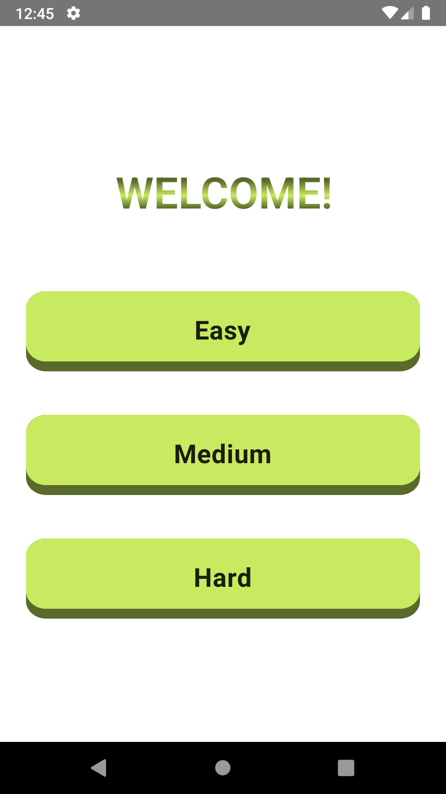
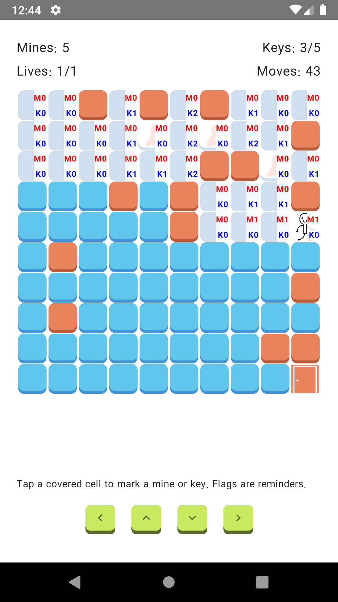
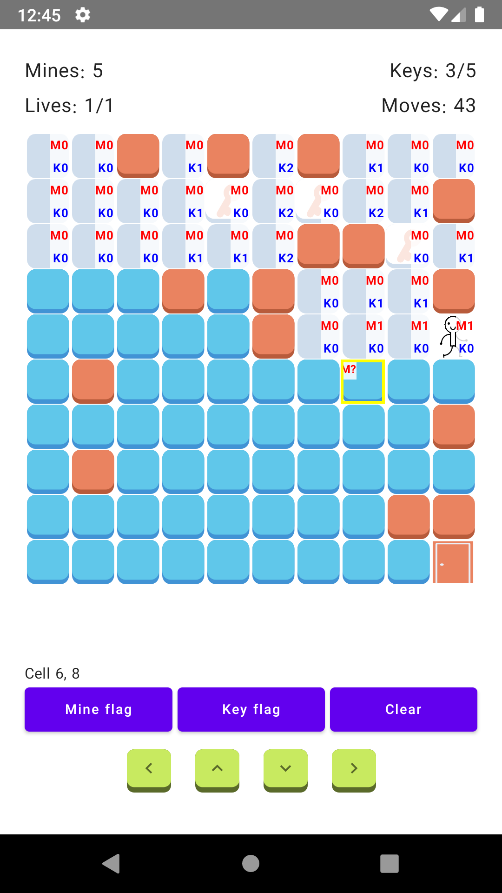
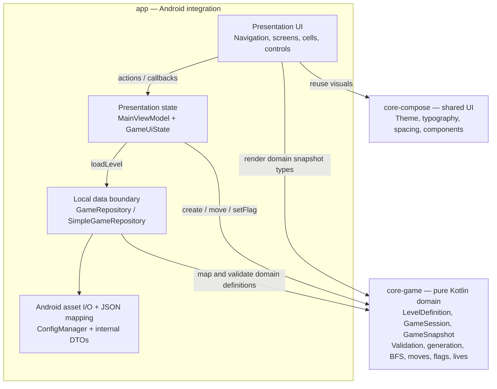
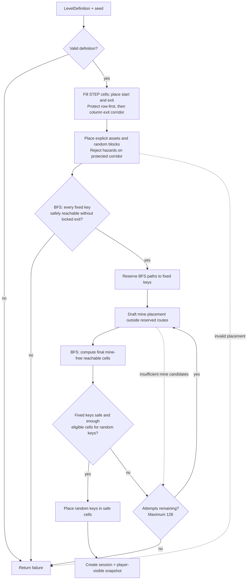

# Mine Sweeper

An offline, single-player Android grid puzzle built with Kotlin and Jetpack Compose. Guide a player across a generated board, use adjacent mine/key clues to explore, collect every key, avoid mines and blocks, and reach the exit. Unlike classic Minesweeper, discovery happens by moving a player rather than opening arbitrary cells.

There are three bundled difficulties (Easy, Medium, Hard). The app has no API calls, sign-in, database, or required network connection. Each new game is generated from a local JSON level definition.

## Game preview

Actual screenshots from the Android app running on a Nexus 5X / API 28 emulator. The gameplay images show the same Easy session, including the compact movement controls.

<table>
  <tr>
    <th>Choose a difficulty</th>
    <th>Explore using clues</th>
    <th>Mark a reminder</th>
  </tr>
  <tr>
    <td></td>
    <td></td>
    <td></td>
  </tr>
</table>

### Rules at a glance

| Feature | Rule |
| --- | --- |
| Discovery | Mines, keys, and unvisited floor cells are hidden. Start, blocks, and exit are visible. |
| Movement | Use the arrows to move one cell north, south, east, or west. Tapping a board cell selects it for a reminder; it does not move the player or reveal the cell. |
| Clues | `M#` and `K#` count mines and keys in the **eight surrounding cells**, including diagonals. Counts describe the original board, so collecting a key does not reduce nearby key clues. |
| Flags | `M?` and `K?` are editable guesses, not confirmed contents. They do not block movement, consume moves, or affect victory. |
| Lives | A mine costs one life and leaves the player on the previous safe cell. Games currently start with one life; the engine supports more. |
| Victory | Collect every key, then reach the unlocked exit. |
| Game over | At zero lives, the game ends. Win and loss both reveal the board for review. |

## Developer guide

- [Quick start](#quick-start)
- [Architecture and layers](#architecture-and-layers)
- [How layers communicate](#how-layers-communicate)
- [Game algorithm and BFS](#game-algorithm-and-bfs)
- [Data and level format](#data-and-level-format)
- [Compose layer and performance](#compose-layer-and-performance)
- [Tests and contributor workflow](#tests-and-contributor-workflow)

Diagrams use Mermaid, which GitHub renders directly. If your Markdown viewer shows diagram source instead, use a Mermaid-capable preview; the surrounding text explains the same flows.

## Quick start

Requirements:

- Android Studio with an Android SDK containing **API 31** and an emulator or device running **API 21+**.
- A JDK compatible with Android Gradle Plugin 7.0.3 (JDK 11 is the expected choice).
- The Gradle wrapper included in this repository; a separate Gradle installation is unnecessary.

Open the repository in Android Studio, let Gradle sync, and run the `app` configuration. From a terminal with `ANDROID_SDK_ROOT` set to your SDK location:

```bash
./gradlew :app:assembleDebug
./gradlew :core-game:test :app:testDebugUnitTest
```

The debug APK is written to `app/build/outputs/apk/debug/app-debug.apk`. Select a difficulty on launch, then use the four on-screen direction controls. The start and visited safe cells show `M` (adjacent mines) and `K` (adjacent keys) counts for their eight neighbors. Tap a covered cell to add an editable mine/key reminder flag; flags do not block movement. The board scrolls on larger levels. A mine consumes a life (currently one life per game), reveals the mine, and leaves the player on the previous safe cell. After a win or loss, choose **Review board**, **Try again**, or **Exit**.

## Architecture and layers

```text
app/           Android entry point, navigation, game UI, ViewModel,
               local-asset repository, JSON mapping, and Koin wiring
core-game/     Pure Kotlin board generation, rules, session, and snapshots
core-compose/  Shared Compose theme and reusable UI components
```

### Module and layer boundaries

The arrows below show **code dependencies/calls**, not the direction of returned UI state. Presentation and local data are logical layers inside `app`; they are not separate Gradle modules.



At the Gradle level, `app` depends on `core-game` and `core-compose`. Neither core module depends on `app` or on the other core module. This keeps framework-specific code out of the game engine.

### Where to find the implementation

| Concern | Main code | Responsibility |
| --- | --- | --- |
| App entry and DI | [`MainActivity`](app/src/main/java/com/mohdroid/minesweeper/MainActivity.kt), [`MineSweeperApplication`](app/src/main/java/com/mohdroid/minesweeper/MineSweeperApplication.kt), [`mainModule`](app/src/main/java/com/mohdroid/minesweeper/main/mainModule.kt) | Set Compose content and connect Koin dependencies. |
| Navigation | [`MainNavGraph`](app/src/main/java/com/mohdroid/minesweeper/navigation/navgraphs/MainNavGraph.kt) | Move between difficulty selection and the game board. |
| Presentation state | [`MainViewModel`](app/src/main/java/com/mohdroid/minesweeper/main/viewmodel/MainViewModel.kt) | Load a level, own the active session, translate user actions into UI state. |
| Local data | [`SimpleGameRepository`](app/src/main/java/com/mohdroid/minesweeper/main/repository/SimpleGameRepository.kt), [`ConfigManager`](app/src/main/java/com/mohdroid/minesweeper/ConfigManager.kt) | Read asset JSON, map it to domain models, and report failures. |
| Game rules | [`GameDomain.kt`](core-game/src/main/kotlin/com/mohdroid/game/domain/GameDomain.kt) | Validate levels, generate boards, apply moves, and return snapshots. |
| Screens and cells | [`BoardGameScreen`](app/src/main/java/com/mohdroid/minesweeper/main/screen/BoardGameScreen.kt), [`MineSweeperCell`](app/src/main/java/com/mohdroid/minesweeper/main/compose/MineSweeperCell.kt) | Render state and emit directional input; they do not decide game rules. |
| Shared UI | [`core-compose`](core-compose/src/main/java/com/mohdroid/compose/) | Theme, typography, spacing, and reusable button/layout components. |

### Why these boundaries?

`core-game` is a plain JVM/Kotlin module. It knows nothing about Android, Compose, JSON, navigation, or dependency injection, so game rules can be tested without an emulator. `core-compose` owns reusable visual primitives but not gameplay. `app` is the Android integration layer: it contains the feature-specific presentation code and the only level data source.

This is intentionally a small, pragmatic layered architecture, **not** a separate Gradle module for every layer. The `GameRepository` interface currently lives in `app`, alongside its local implementation, because there is only one offline data source. The domain models and rules still point outward to no Android dependency. If additional data sources or features are introduced, the repository contract could be moved to a domain-facing module without changing the core game rules.

Koin creates `MainViewModel`, binds `GameRepository` to `SimpleGameRepository`, and provides `ConfigManager` for reading Android assets. There is no network client or authentication layer to configure.

### Architecture decisions and tradeoffs

| Decision | Why it fits this project | Boundary to preserve |
| --- | --- | --- |
| Pure Kotlin game engine | Rules and seeded board generation can be tested quickly on the JVM without Android. | Do not add Compose, Android context, JSON DTOs, or DI to `core-game`. |
| One cohesive `GameSession` | Movement, discovery, flags, keys, and lives operate on the same board and lifecycle. Separate use-case classes for every small action are not currently necessary. | Keep gameplay decisions here, not in the ViewModel or Composables. |
| Local repository inside `app` | The only data source is bundled JSON; additional data modules would add little value today. | Repository and DTO details must not leak into the engine. Move the contract outward if multiple consumers/data sources justify it. |
| ViewModel-owned session and read-only state flow | The ViewModel coordinates loading and owns the active session; screens render the published state. | UI code sends intentions, rather than mutating the board. |
| Player-visible snapshots | Hidden contents stay internal while the UI receives everything needed to render. | A covered cell must not expose whether it is a mine, key, or floor. |
| Shared UI module separate from rules | Styling can evolve independently of gameplay. | Keep game-specific cells and screens in `app`; share genuinely reusable visuals only. |

This is **pragmatic layering inspired by Clean Architecture**, not a claim of strict Clean Architecture: the repository interface currently lives in `app`, and there is no separate use-case layer or module per feature.

## How layers communicate

### Starting a game: assets → domain → screen

```mermaid
sequenceDiagram
    actor Player
    participant UI as Compose / Navigation
    participant VM as MainViewModel
    participant Repo as SimpleGameRepository
    participant Assets as ConfigManager / JSON assets
    participant Engine as GameSession (core-game)
    Player->>UI: Select difficulty
    UI->>VM: onLevel(difficulty)
    VM-->>UI: StateFlow: LOADING
    Note over UI,VM: Navigate to board; render loading state
    VM->>Repo: loadLevel(difficulty)
    Repo->>Assets: Read bundled JSON
    Assets-->>Repo: JSON text
    Note over Repo: IO dispatcher: parse DTOs, map, validate
    Repo-->>VM: Result of LevelDefinition
    alt Definition loaded successfully
        VM->>Engine: create(level)
        Note over Engine: Default dispatcher: generate board and check routes
        alt Session created successfully
            Engine-->>VM: Session and initial snapshot
            VM-->>UI: StateFlow: READY + GameSnapshot
            UI-->>Player: Render board, stats, clues, controls
        else Generation failure
            Engine-->>VM: Failure
            VM-->>UI: StateFlow: ERROR + message
            UI-->>Player: Show retry action
        end
    else Read, mapping, or validation failure
        VM-->>UI: StateFlow: ERROR + message
        UI-->>Player: Show retry action
    end
```

`MainNavGraph` collects `uiState` and passes it down with callbacks. `MainViewModel` cancels the previous load job when another level is requested. Both level-load failures and session-generation failures become an explicit `ERROR` state.

### During play: intention → rule → snapshot → render

```mermaid
sequenceDiagram
    actor Player
    participant UI as Compose board / controls
    participant VM as MainViewModel
    participant Engine as Existing GameSession
    Player->>UI: Tap direction or choose reminder flag
    UI->>VM: onMovement(direction) / onFlag(position, kind)
    VM->>Engine: move(direction) / setFlag(position, kind)
    Note over Engine: Check rules; update internal board only if accepted
    Engine-->>VM: GameSnapshot
    alt Snapshot changed
        VM-->>UI: Publish updated GameUiState
        UI-->>Player: Render new position, counters, clues, flags
    else Invalid move or unchanged flag
        Note over VM,UI: Same snapshot instance; no new UI state emitted
    end
    Note over UI,Engine: No asset loading or board generation on this path
```

Selecting a covered cell is local UI state; choosing **Mine flag**, **Key flag**, or **Clear** sends a domain action. Flags belong to the session, while selection highlighting and dismissing the review dialog belong to Compose.

## Game algorithm and BFS

The central API is `GameSession.create(level, seed, startingLives)` followed by `session.move(direction)`, `session.setFlag(position, flag)`, and `session.snapshot()`. A session owns the true mutable board internally; callers receive `GameSnapshot` values containing only player-visible cell information. The optional seed makes random placement reproducible in tests. `startingLives` defaults to one, but the rule supports higher values. Normal gameplay uses a fresh seed, so **Try again** creates a new layout from the same difficulty definition.

### 1. Validate and generate a board

`LevelDefinition.validate()` requires a positive board size, exactly one start and one exit, explicit positions for both, non-negative counts, in-bounds and non-duplicate explicit positions, and no more requested tiles than board cells. `GameSession.create` returns a `Result` failure if validation or placement cannot succeed; the ViewModel displays an error state with a retry action.

Generation then:

1. Fills the rectangular board with `STEP` cells and places the explicit `START` and `EXIT`.
2. Computes a direct route from start to exit: first along rows, then along columns. This is the *protected path*.
3. Places all other explicitly positioned assets. An explicit block or mine on the protected path is rejected.
4. Randomly places remaining blocks outside the protected path.
5. Runs **breadth-first search (BFS)** through non-block, non-mine cells to check that explicitly positioned keys are reachable without crossing the locked exit. It reserves safe routes to those keys and the exit.
6. Places remaining mines outside those routes, then runs BFS again, treating mines, blocks, and the locked exit as impassable. Random keys are placed only in safely reachable cells. If a mine layout leaves too few valid key cells, it retries the random placement. Any unassigned cells stay as `STEP`.

Candidates are shuffled with the session's seed before selection. This gives deterministic layouts for a fixed level and seed while varying layouts in ordinary play. The protected route stays clear of blocks and mines; every key has a mine-free route from the start that does not require passing through the locked exit. Explicitly positioned assets are authoritative. Impossible level constraints are reported as a failure rather than silently changing the level.



**Where BFS is used:** `reachablePositions` explores cardinal neighbors with a FIFO queue and a visited set to check whether safe paths exist. `safePath` also uses BFS, recording parent positions so a route to an explicitly positioned key can be reconstructed and protected. These searches exclude blocks, mines when requested, and the locked exit when checking key access.

**What BFS does not do:** it does not randomly place assets, construct the initial row/column exit corridor, or reveal cells during play. The generator combines seeded random placement with BFS reachability checks. A single BFS visits at most the board's cells and their four edges per cell: **O(rows × columns)** time and space. Generation may run several searches and up to 128 placement attempts; it is not just one BFS.

The guarantee is **safe reachability**, not that every board can be solved from clues without guessing. Clues use eight neighbors; movement and BFS use four.

### 2. Apply a movement

Each direction moves one row or column; there is no diagonal movement. `GameSession.move` checks the proposed cell before changing state:

| Condition | Result |
| --- | --- |
| Game already won or lost | Ignore the move. |
| Target outside the board or a `BLOCK` | Ignore the move. |
| Target is `EXIT` with keys still missing | Ignore the move; the door stays locked. |
| Target is an uncollected `KEY` | Move, reveal it, and increment collected keys. |
| Target is an unrevealed `MINE` | Consume one life, reveal it, and stay on the previous safe cell; enter `LOST` at zero lives. |
| Target is an already revealed `MINE` | Ignore the move; it cannot consume another life. |
| Target is an unlocked `EXIT` | Move and enter `WON`. |
| Other traversable target | Move, reveal it, and show its adjacent mine/key counts. |

Only accepted moves, including a first mine hit, increase the move count. A key counts once even if the player revisits its cell. The exit unlocks when `foundKeys == totalKeys`; reaching it then wins the game. A terminal phase stops further movement. Flags (`NONE`, `MINE`, `KEY`) are editable reminders on covered cells; they neither block movement nor change clues or victory conditions.

### 3. Publish a renderable snapshot

`GameSnapshot` contains the player position, counters, lives, phase, and a read-only view of visible cells. Unvisited steps, mines, and keys all have a `null` tile in the snapshot; the secret board never escapes `GameSession` during play. Visited safe cells carry static counts of mines and keys in their eight neighbors. On win/loss, all true tiles are exposed for board review. Invalid moves return the **same snapshot instance**. Accepted moves and flag changes copy only changed board rows and share unchanged rows/cells with the previous snapshot; the terminal reveal is intentionally a full-board update.

| State | What the UI receives |
| --- | --- |
| Covered floor, mine, or key | `tile = null`, no clue counts, optional reminder flag. |
| Visited safe cell | Actual tile plus static adjacent mine/key counts. |
| Start, block, or exit | Visible tile from the beginning; clues only if visited and safe. |
| Mine hit while lives remain | Revealed mine, cleared flag, reduced lives; player stays on the safe cell. |
| `WON` or `LOST` | All tiles revealed; remaining flags retained for comparing guesses. |

## Data and level format

The repository chooses one of the bundled files in [`app/src/main/assets`](app/src/main/assets/): `easyLevelDetail.json` (10×10), `mediumLevelDetail.json` (15×15), or `hardLevelDetail.json` (20×20). `ConfigManager` reads the file; Gson parses internal JSON DTOs; `SimpleGameRepository` maps those DTOs to `LevelDefinition` and validates them before session creation. JSON types do not cross into `core-game`.

| Difficulty | Board | Blocks | Mines | Keys |
| --- | --- | --- | --- | --- |
| Easy | 10 × 10 | 15 | 5 | 5 |
| Medium | 15 × 15 | 20 | 18 | 10 |
| Hard | 20 × 20 | 50 | 58 | 10 |

A minimal level looks like this:

```json
{
  "rows": 2,
  "cols": 3,
  "assetDetails": [
    { "type": "START", "count": 1, "positions": [{ "x": 0, "y": 0 }] },
    { "type": "EXIT",  "count": 1, "positions": [{ "x": 0, "y": 2 }] },
    { "type": "KEY",   "count": 1, "positions": [{ "x": 1, "y": 0 }] }
  ]
}
```

`x` maps to the **row** and `y` maps to the **column** in this project's JSON format. `type` must match a `TileKind` name: `START`, `EXIT`, `BLOCK`, `MINE`, `KEY`, or `STEP`. `count` is the total requested for that type; `positions` reserves some or all of those placements. Omitted positions are generated where applicable. `STEP` is the default fill tile; its declared count is not used to place additional random tiles, so do not treat it as an independently enforced board-size total.

When editing a level, keep start/exit unique and explicitly positioned, avoid duplicate coordinates, and leave sufficient eligible space for requested blocks, mines, and keys. The repository test loads and generates all three bundled levels; extend that test when changing their format or constraints.

## Compose layer and performance

`MainNavGraph` owns the two destinations. Selecting a difficulty asks the ViewModel to start a level, then navigates to the board. The board collects the ViewModel's `StateFlow<GameUiState>` and passes state and callbacks to `BoardGameScreen`. The screen handles `IDLE`/`LOADING`, `ERROR`, and `READY` explicitly. In `READY`, `GameStats` shows counters and lives, `Board` supports scrolling and cell selection, `MineSweeperCell` renders covered/revealed tiles with clue or flag overlays, and `MineSweeperControllers` emits `Direction` values. The finish dialog allows a full-board review for `WON` or `LOST`.

Level file reads and JSON mapping run on an IO dispatcher. Board generation runs on `Dispatchers.Default`; the ViewModel publishes the result to `StateFlow` when ready. Movement is applied to the already-created session, not by reloading the asset or regenerating a board for each tap. Rejected moves do not emit a new UI state. The snapshot's row sharing further limits allocations during accepted moves. Compose remains a renderer of state, not the owner of the game rules.

The active session is held by `MainViewModel` in memory. There is currently no saved-game persistence or restoration after process death; a fresh level selection starts a new session.

### UI responsibilities

| Component | Owns | Does not own |
| --- | --- | --- |
| `MainNavGraph` | Destination changes, state collection, callback wiring. | Game rules or level parsing. |
| `BoardGameScreen` | Loading/error/ready layouts, selected cell, review-dialog visibility. | The authoritative game session. |
| `Board` / `MineSweeperCell` | Cell layout, scrolling, visible tile/clue/reminder rendering, accessibility descriptions. | Hidden tile contents or reachability decisions. |
| `MineSweeperControllers` | Compact direction buttons; 36 dp visible arrows within 48 dp touch targets. | Validating moves. |
| `core-compose` | Reusable theme and UI primitives. | Feature-specific state or game logic. |

The board retains a minimum cell size and scrolls when necessary, rather than shrinking large levels into unreadable cells. The single-row movement controls leave more vertical space for the board.

### Why taps should not reload a screen

Normal movement and flag actions reuse the existing session. Only selecting a difficulty, retrying a failed load, or choosing **Try again** runs the load/generation path. Updated state may cause Compose to recompose; that is different from re-reading JSON or rebuilding the game. Unchanged snapshot rows/cells are shared to reduce allocation, but this is not a guarantee that Compose skips every unchanged cell—measure recomposition and frame timing when assessing UI performance.

### Current scope and extension points

There is no nickname flow, results history, leaderboard, remote service, or authentication. More lives can be enabled through `GameSession.create(..., startingLives = n)` without changing the move contract. Persistence or results tracking would need a separate local data boundary; they should not become responsibilities of the Composables or board generator.

## Tests and contributor workflow

Run the relevant JVM suites with:

```bash
./gradlew :core-game:test :app:testDebugUnitTest
```

[`GameSessionTest`](core-game/src/test/kotlin/com/mohdroid/game/domain/GameSessionTest.kt) covers level rejection, seeded generation, safe key routes, hidden snapshots, eight-neighbor clues, flags, lives, mine hits, locked exits, boundary moves, victory, snapshot reuse, and structural sharing. [`SimpleGameRepositoryTest`](app/src/test/java/com/mohdroid/minesweeper/main/repository/SimpleGameRepositoryTest.kt) covers JSON mapping, read failures, and multiple seeds for every bundled difficulty. These are JVM unit tests; they do not require a running emulator. For UI changes, also run the app on an emulator/device and exercise each difficulty and the win/loss/retry flow.

When changing the project, keep these ownership rules:

- Put placement and movement rules in `core-game`, with a focused JVM test.
- Keep Android asset I/O and JSON mapping in `app`'s repository; pass domain models into `GameSession`.
- Expose screen-ready state through `MainViewModel`; make Composables render state and send actions back.
- Put only genuinely reusable Compose styling/components in `core-compose`; keep game-specific cells and controls in `app`.

The main build versions are centralized in [`gradle-script/dependencies.gradle`](gradle-script/dependencies.gradle). This project currently uses Kotlin 1.5.21, Android Gradle Plugin 7.0.3, and Jetpack Compose 1.1.0-alpha01, so check compatibility before upgrading any one of them independently.
